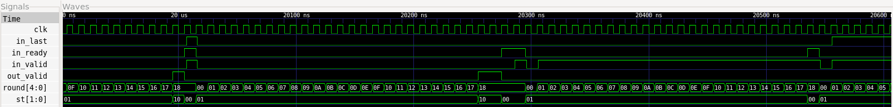
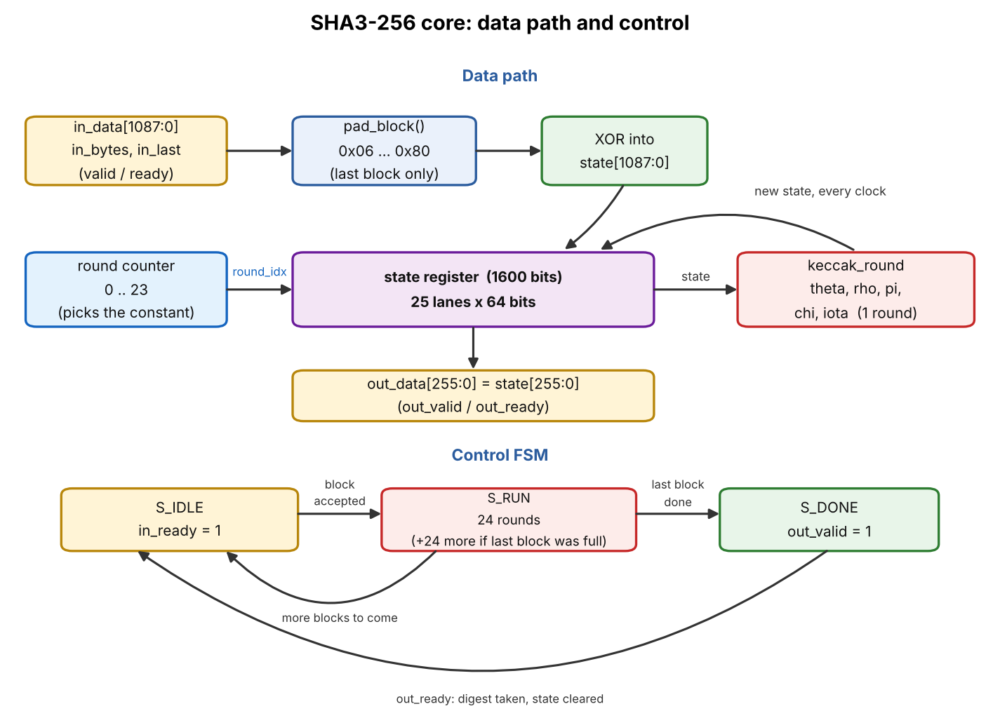

# SHA3-256 Hash Accelerator (Verilog RTL)

A SHA3-256 hash core in Verilog RTL, verified in simulation and synthesized with Yosys.
It takes a message in 136-byte blocks, does the padding itself, runs the Keccak-f[1600]
permutation at one round per clock, and returns a 256-bit digest.
Everything is checked against Python's `hashlib`.

## Files
| File | What it is |
|---|---|
| `rtl/keccak_round.v` | One Keccak round (theta, rho, pi, chi, iota), purely combinational |
| `rtl/sha3_256.v` | Top core: 3-state FSM (IDLE, RUN, DONE), padding, valid/ready handshakes |
| `tb/tb_sha3_256.v` | Self-checking testbench |
| `model/keccak_ref.py` | Readable Python reference model |
| `model/gen_vectors.py` | Makes 627 test vectors with `hashlib` as the golden model |
| `model/check_model.py`, `model/rtl_mirror.py` | Extra Python checks (no simulator needed) |

## How to run (WSL2 / Ubuntu)
```
sudo apt install iverilog gtkwave make
make sim      # generates vectors, compiles with Icarus, runs the testbench
make wave     # open the waveform in GTKWave
make model    # Python-only checks
```
Expected: `ALL TESTS PASSED` and `Vectors passed: 627 / 627`.

## Results (measured with Icarus Verilog 12)
```
Latency, single-block message: 25 clock cycles (block accepted -> digest valid)
Vectors passed: 627 / 627,  other errors: 0
ALL TESTS PASSED
```
Waveform (GTKWave): `st` = 00 idle, 01 running, 10 digest ready; `round` counts 0 to 23 (hex 17), one round per clock.



## Synthesis (Yosys 0.33, generic gate library)
```
yosys -p "read_verilog rtl/keccak_round.v rtl/sha3_256.v; synth -top sha3_256 -flatten; stat"
```

| Metric | Result |
|---|---|
| Yosys design check | 0 problems |
| Total cells | 15,387 |
| Flip-flops | 1,609 (1,600 state bits + 9 control bits) |
| XOR / XNOR | 5,901 |
| ANDNOT / MUX / OR | 4,212 / 2,482 / 685 |

These are generic gate counts before technology mapping. They show design size only, not chip area, timing or power.

## How it works


* State = 1600 bits = 25 lanes x 64 bits. Rate = 1088 bits (136 bytes), capacity = 512 bits.
* Absorb: XOR a 136-byte block into the first 1088 bits of the state, then run 24 rounds.
* Round = theta (mix columns), rho (rotate lanes), pi (move lanes), chi (the only non-linear step), iota (add a round constant).
* Padding for SHA3-256: append byte 0x06, zeros, and 0x80 in the last byte of the block.
  If the last block is already 136 bytes full, the core adds one extra all-padding block by itself.
* Squeeze: the digest is the first 256 bits of the state.
* Latency: 25 clocks per block (1 absorb + 24 rounds + digest visible); 49 clocks if the extra padding block is needed (24 more rounds; this case is functionally tested by the 136-byte vectors, the cycle count comes from the Python model of the state machine, not measured in the Verilog sim).

## Interface
`in_valid/in_ready`, `in_data[1087:0]` (byte i at `[8*i +: 8]`), `in_bytes` (valid bytes, 136 unless last block),
`in_last`, and `out_valid/out_ready`, `out_data[255:0]` (byte j at `[8*j +: 8]`).

## Verification
* 627 vectors: the standard published test messages (empty, "abc", 448-bit and 896-bit), whose
  digests are also checked against the published values; lengths around the 136-byte block edge
  (134, 135, 136, 137, 271-273, 407-409), all-zero and all-one blocks, a 1000-byte message,
  and 600 random messages (0-420 bytes).
* Random idle gaps on the input and random back-pressure on the output.
* Random garbage in the unused bytes of the last block (the core must ignore it).
* Monitor checks that the digest stays stable while `out_ready` is low.
